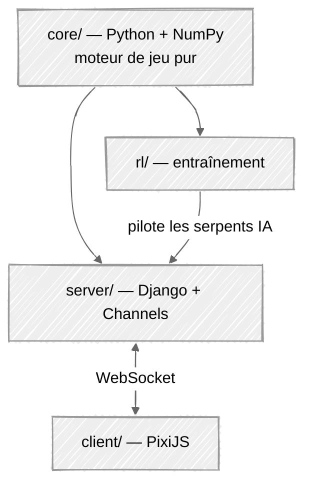

# Slither-Royale - Cahier des charges

## Contexte et définition du projet

### Le besoin

Notre objectif est de réaliser un projet qui implique le développement d'un modèle de reinforcement learning (apprentissage par renforcement), sous la forme d'une application Python qui se lance en une seule commande.

Le problème concret : un jeu multijoueur en ligne n'est jouable que si assez de joueurs sont connectés en même temps. Un battle royale à 16 est vide à 3 joueurs, et personne n'est en ligne le jour d'une démonstration.

### La solution

Slither Royale est un jeu multijoueur jouable dans le navigateur. Les places libres de chaque partie sont remplies par des serpents contrôlés par la machine : des bots scriptés d'abord, puis une politique entraînée par apprentissage par renforcement. Une partie compte donc toujours 16 serpents, quel que soit le nombre d'humains connectés, et le modèle entraîné est mis en valeur directement dans le jeu.

Autour du jeu, un site Django gère les comptes, le lobby et l'historique des parties.

### Critères du projet

Les critères attendus sont les suivants :

- Python majoritaire : seul le code Python est évalué.
- Docker obligatoire : `git clone`, puis une seule commande pour lancer le projet.
- Un résultat visuel, qui peut être facilement présenté à l'oral (la démo est obligatoire en soutenance)
- Implémentation d'un composant réseau
- Un projet réaliste

Notre projet consiste donc à créer un jeu vidéo (visuel) multijoueur (composant réseau), servi par Django et livré dans Docker.

### Ressources

On dispose de 12 séances de 3h15 pour réaliser le projet, soit environ 36h de travail au total. Le projet sera réalisé en groupe de 3 personnes, ce qui donne une petite centaine d'heures allouées en tout pour le projet.

Les ressources nécessaires au projet sont :

| Ressource | Solution choisie |
| --- | --- |
| Hébergement | Docker Compose : le projet tourne sur la machine de l'enseignant, avec la même commande sous Linux et macOS. La VM Minet n'est plus nécessaire pour l'évaluation ; elle reste une option pour une démo publique (Lot 3). |
| Base de données | PostgreSQL, dans un conteneur de la même stack Docker. |
| Librairies utilisées | Nous avons choisi d'utiliser uniquement des librairies sous licence MIT (à compléter avec d'autres licences à droit d'utilisation gratuit), afin de ne pas avoir de problème de droit d'auteur. |
| Entraînement des modèles | L'utilisation de Google Colab est privilégiée pour l'entraînement des modèles. |

## Principe du jeu

Slither Royale est une adaptation façon remix de Slither.io en battle royale.

16 joueurs incarnent un serpent (abstrait) vu de dessus, sur une carte circulaire en 2D. Le serpent avance continuellement vers l'avant, et le joueur peut le diriger vers la droite ou la gauche, en direction du curseur de la souris.

Lorsqu'un serpent entre dans un autre serpent (sa tête touche l'autre serpent), il disparaît et perd la partie. L'objectif des joueurs est d'être le dernier serpent sur la carte.

Le joueur est récompensé pour l'élimination d'autres serpents, et un système de zone de jeu est mis en place pour forcer les joueurs à se rapprocher les uns des autres au fur et à mesure que le temps passe.

## Architecture

### Règle d'or

`core/` ne connait ni Django, ni WebSocket, ni Gymnasium. Il expose une seule opération : `tick(actions) -> nouvel état`. Il ne dort jamais, ne lit jamais l'heure, n'ouvre aucune socket.

- **L'entraînement** appelle `tick()` en boucle serrée, aussi vite que le CPU le permet.
- **Le serveur** appelle exactement le même `tick()`, mais cadencé par une horloge.

### Découpage des dossiers

| Dossier | Rôle | Dépend de |
| --- | --- | --- |
| `core/` | Règles du jeu : déplacement, collisions, zone, conditions de victoire | NumPy uniquement |
| `rl/` | Environnement d'entraînement, encodage des observations, récompenses, scripts de training, export des poids | `core/`, Gymnasium, Stable-Baselines3 (hors image Docker) |
| `server/` | Projet Django : comptes, lobby, historique (pages HTMX), admin, et boucle de partie temps réel | `core/`, Django, Channels, PostgreSQL |
| `client/` | Rendu PixiJS de la partie, capture de la souris, interpolation | - (parle au serveur en WebSocket) |
| racine | `Dockerfile`, `docker-compose.yml`, `run.sh`, configuration nginx | Docker |

Le code de `client/` est en TypeScript, donc non évalué : il est volontairement réduit au rendu de la partie. Toute la logique (règles, validation des entrées, comptes, pages) reste en Python.

## Fonctionnalités

Chaque mécanique ajoutée coûte du temps de développement et rend l'entraînement plus difficile. Les fonctionnalités sont donc découpées en lots : le MVP doit absolument être fait pour la fin du projet, les lots suivants sont traités dans l'ordre, si le temps le permet.

### MVP - le strict minimum fonctionnel

**Jeu**

- Survie pure : longueur fixe, vitesse constante, pas de nourriture.
- Une seule action possible : tourner à gauche, tout droit, ou à droite.
- Collisions tête / corps, bord de la carte circulaire, zone de jeu qui rétrécit pour forcer la confrontation, condition de victoire.
- Partie temps réel à 16 serpents : serveur autoritaire, boucle de partie cadencée, protocole WebSocket.
- Rendu PixiJS de la carte, des serpents et de la zone ; la souris donne la direction.
- Bots scriptés (éviter les obstacles, rester dans la zone) qui remplissent les places libres.

**Site (critères Appli web)**

- Comptes et authentification ; jouer et consulter son historique demande d'être connecté.
- Lobby : rejoindre une partie.
- Résultat de chaque partie enregistré en base, et historique du joueur (sans requêtes N+1).
- Admin Django utilisable pour tous les modèles.
- Pages d'erreur 404 et 500 personnalisées.

**Livraison (critères Docker)**

- `./run.sh` lance la stack : nginx (port 8080), Django sous Daphne, PostgreSQL.
- Au lancement : migrations appliquées, `collectstatic`, compte `admin` / `projetinfo1A` créé s'il n'existe pas.
- Healthcheck sur `/health/`.
- `README.md` de lancement et de test, avec le graphe des modèles à jour (`graph_models`).

### Lot 1 - finitions et bonus

Par ordre de priorité :

1. CI/CD GitHub Actions : build de l'image et tests (bonus +5 ; ruff et pytest tournent déjà sur chaque pull request).
2. HUD (serpents restants, éliminations) et écran de fin de partie.
3. Reconnexion WebSocket après une coupure.
4. Classement des joueurs (page HTMX).

### Lot 2 - IA entraînée

1. Wrapper Gymnasium autour de `core/`, encodage des observations, fonction de récompense.
2. PPO (Stable-Baselines3) sur Colab contre les bots scriptés, puis self-play.
3. Évaluation contre les bots scriptés.
4. Export de la politique et remplacement des bots scriptés dans le jeu.

### Lot 3 - extensions

- Croissance du serpent à chaque élimination.
- Boost de vitesse.
- Image publiée sur ghcr.io, pour linux/amd64 et linux/arm64.
- Déploiement public de la stack Docker sur la VM Minet.

## Choix techniques

### Stack

| Couche | Technologie |
| --- | --- |
| Langage principal | Python 3.12 |
| Moteur de jeu | NumPy |
| Web | Django, Django Channels, HTMX |
| Serveur ASGI | Daphne |
| Base de données | PostgreSQL |
| Rendu de la partie | PixiJS (TypeScript, Vite) |
| Apprentissage | Gymnasium, Stable-Baselines3 (PyTorch), Google Colab |

### Cœur de jeu

| Retenu | Pourquoi | Écarté |
| --- | --- | --- |
| Python + NumPy | Même langage que l'entraînement et que Django : un seul moteur, aucune réimplémentation. NumPy traite les 16 serpents d'un coup et évite le coût d'un objet Python par segment. | **Moteur JS partagé client/serveur** : imposerait un pont Python↔JS pour l'entraînement RL |

### Entraînement

| Retenu | Pourquoi | Écarté |
| --- | --- | --- |
| Gymnasium | Interface standard `reset()` / `step()`. Rend le moteur compatible avec tout l'écosystème RL sans code spécifique. | - |
| Stable-Baselines3 (PPO, sur PyTorch) | PPO fiable et déjà éprouvé. Nous écrivons nous-mêmes ce qui est propre au projet - observations, récompenses, self-play. | **PPO écrit à la main** : beaucoup d'architecture en plus, pour un résultat au mieux équivalent. Autant respecter le DRY de Python. **RLlib** : conçu pour du calcul distribué, surdimensionné ici. |
| Self-play : 16 serpents, une seule politique | Un seul monde simulé produit 16 transitions par tick au lieu d'une : les données sont quasi gratuites, et les adversaires progressent en même temps que l'agent. | **Adversaires scriptés uniquement** : l'agent apprend à battre des bots, pas à jouer. Conservés seulement comme point de départ. |
| Google Colab | GPU gratuit (TPU v5e) | Machine personnelle seule : limitante pour des gros runs. |
| Inférence en NumPy dans le serveur | La politique est un petit réseau : ses poids sont exportés et le serveur fait le calcul avec NumPy, déjà présent. L'image Docker n'embarque ni PyTorch ni Stable-Baselines3. | **PyTorch dans l'image** : plusieurs centaines de Mo pour quelques multiplications de matrices. |

### Serveur

| Retenu | Pourquoi | Écarté |
| --- | --- | --- |
| Django | Recommandé par les consignes, et pertinent : lobby, comptes et historique de parties passent par l'ORM et l'admin, quasi gratuitement. | - |
| HTMX | Pages dynamiques (lobby, historique, classement) rendues côté serveur par des templates Django : le code reste en Python, donc évalué. | **SPA en JavaScript** : code non évalué, et une API à écrire en plus. |
| Django Channels (ASGI) | Apporte le WebSocket dans Django : un seul projet, un seul déploiement, et la session Django sert directement à identifier le joueur. | **Serveur temps réel séparé (Node, FastAPI)** : deux services, deux déploiements, et l'authentification à repartager. |
| Daphne | Serveur ASGI maintenu par le projet Django, référence de Channels : sert HTTP et WebSocket dans un seul processus. | **runserver** : serveur de développement, exclu par la grille. **Gunicorn (WSGI)** : pas de WebSocket. |
| Channel layer en mémoire | Une partie tient dans un seul processus : aucun message à partager entre processus. | **Redis** : un service de plus, utile seulement à partir de plusieurs processus Daphne. |
| WebSocket | Bidirectionnel, faible latence, natif dans le navigateur. | **Polling HTTP** : latence trop élevée. **WebRTC / UDP** : gain réel, mais complexité sans rapport avec 16 joueurs sur une carte réduite. |
| Serveur autoritaire | Seul l'état du serveur fait foi ; le client n'envoie qu'une direction souhaitée, validée par le serveur. Anti-triche par construction. | **Client autoritaire** : triche triviale et clients désynchronisés. |
| IA en remplissage de slots | La partie compte toujours 16 serpents : les humains connectés, l'IA pour le reste. Résout le problème « personne en ligne le jour de la démo » et met le modèle entraîné en valeur directement dans le jeu. | **Mode démo séparé** : découplage plus simple, mais l'IA n'est plus qu'une vidéo à côté du jeu. |
| Persistance des résultats de partie uniquement | Écrire chaque tick en base n'apporte rien et écroule les performances. | Journalisation tick par tick. |

### Base de données

| Retenu | Pourquoi | Écarté |
| --- | --- | --- |
| PostgreSQL | Exigé par la grille en production. Image Docker officielle, données dans un volume. On n'y écrit que les comptes, les avatars (chemins) et les résultats de partie. | **SQLite** : exclu par la grille. **MySQL** : équivalent pour notre usage, aucun avantage à en attendre. |

### Client

| Retenu | Pourquoi | Écarté |
| --- | --- | --- |
|   PixiJS, limité au rendu de la partie | Rendu WebGL 2D. Sprites, traînées et effets lumineux disponibles d'origine. Le TypeScript n'étant pas évalué, le client se contente d'afficher l'état reçu et d'envoyer la direction. | **Canvas 2D brut** : viable, mais rendu plus pauvre pour une démonstration orale. **Three.js** : moteur 3D, inadapté à une carte 2D. |

### Livraison et licences

| Retenu | Pourquoi | Écarté |
| --- | --- | --- |
| Docker Compose : nginx, Django, PostgreSQL | Imposé par les consignes. Une commande lance toute la stack, sur Linux comme sur macOS. | **Installation manuelle sur la VM Minet** (v1) : non reproductible sur la machine de l'enseignant. |
| Image construite sur place (option A) | `docker compose up` construit l'image depuis les sources : rien à publier, et l'image est native sur PC comme sur Mac. Le client PixiJS est compilé dans une étape de build Node séparée, absente de l'image finale. | **Image ghcr.io multi-architecture (option B)** : build croisé amd64/arm64 à maintenir. Gardée pour le Lot 3. |
| nginx devant Daphne | Sert les statiques, les médias et le client compilé, et transmet HTTP et WebSocket à Django. | **Statiques servis par Django** : exclu par la grille. |
| Script d'entrée du conteneur | Migrations, `collectstatic` et création du compte `admin` / `projetinfo1A` à chaque lancement, sans action manuelle. Les migrations sont versionnées dans git. | **Migrations générées dans le conteneur** : exclu par la grille. |
| Librairies sous licence MIT ou équivalent libre d'usage | Aucun risque de droit d'auteur sur un projet rendu et présenté. Django, Channels et Daphne (BSD), HTMX (BSD), PixiJS (MIT), PyTorch (BSD), Stable-Baselines3 (MIT), NumPy (BSD), PostgreSQL (licence PostgreSQL) et nginx (BSD) satisfont tous ce critère. | Toute dépendance sous licence restrictive ou commerciale. |

### Qualité et suivi

| Retenu | Pourquoi | Écarté |
| --- | --- | --- |
| black + isort, ruff, pytest | Formatage imposé par la grille ; ruff et pytest tournent déjà sur chaque pull request. Code et commentaires en anglais. | - |
| GitHub Actions | Étendu au build de l'image Docker et aux tests : bonus CI/CD (+5). | - |
| Issues GitHub comme cahier de labo | Une issue par tâche, ouverte quand le travail commence, fermée quand il est fini, avec son assigné. Les jalons O0 à O8 regroupent les issues. | - |

## Planning

### Répartition des tâches

| | |
| --- | --- | 
| Jonathan Heilmann | `core/` : moteur, collisions, zone, tests de déterminisme ; bots scriptés ; IA 
| Allan Amri | `server/` : Django, comptes, modèles, admin, pages HTMX, boucle de partie Channels, PostgreSQL
| Alexandre Vial | `client/` PixiJS ; Channels ; Docker, nginx, CI/CD |
| Tous | Intégration, Docker, nginx, CI/CD, `README.md`, slides, répétitions : chacun doit pouvoir répondre sur tout le projet |

Le détail (qui fait quoi, et quand) est tenu dans les issues GitHub.

### Répartition indicative de l'effort

(Les estimations sont a titre indicative elle peuvent varier selon les imprévus et la complexité rencontrée)

| Lot | Estimation |
| --- | --- |
| Cœur de jeu et tests de déterminisme | 15 h |
| Django : comptes, lobby, historique, admin, pages HTMX | 15 h |
| Boucle de partie Channels, protocole WebSocket | 10 h |
| Client PixiJS : rendu, entrées, interpolation | 12 h |
| Docker, nginx, PostgreSQL, CI/CD | 10 h |
| Bots scriptés et remplissage des slots | 5 h |
| IA : environnement RL, entraînement, intégration (Lot 2) | 25 h |
| README, slides, préparation de l'oral | 10 h |

Un autre avantage de cette implémentation est qu'une fois le cœur de jeu posé, les autres parties peuvent être développées en parallèle : l'entraînement avance en même temps que le serveur et le client.

### Livrables

| Livrable | Forme | Échéance |
| --- | --- | --- |
| Cahier des charges | Ce fichier | 18 oct. 23h59 |
| Cahier de labo | Issues GitHub | Tenu au fil du projet |
| Code | Dépôt GitHub | 8 déc. 23h59 (dernier commit pris en compte) |
| README | `README.md` à la racine : lancer, se connecter, tester | 8 déc. 23h59 |
| Slides | PDF | 8 déc. 23h59 |